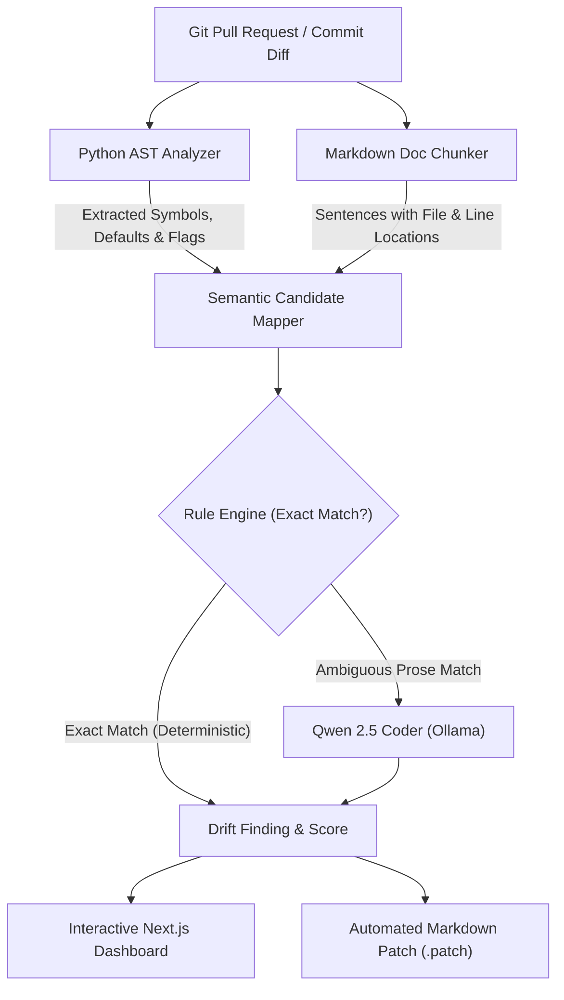

# 🛡️ DocGuard — AI-Powered Documentation Intelligence Platform

[](https://github.com/Nobody-KnowsBetter/ooli/actions/workflows/ci.yml)
[](https://ooli-wine.vercel.app)
[](https://github.com/Nobody-KnowsBetter/ooli)
[](https://www.python.org/downloads/)
[](https://fastapi.tiangolo.com)
[](https://nextjs.org)
[-orange.svg)](https://ollama.com)
[](LICENSE.md)

> **Prevent documentation rot before code merges.** DocGuard detects the exact sentences in your docs that a pull request or code change invalidated, pinpoints the responsible code diff, and generates one-click automated fixes.

🌐 **Live Demo Website:** [docguard-org.vercel.app](docguard-org.vercel.app)

---

## 🚀 Use It On Your Repository (GitHub Action)

Add `.github/workflows/docguard.yml` to any GitHub repository:

```yaml
name: DocGuard

on:
  pull_request:

permissions:
  contents: read
  pull-requests: write

jobs:
  docguard:
    runs-on: ubuntu-latest
    steps:
      - uses: actions/checkout@v4
        with:
          fetch-depth: 0
      - uses: Nobody-KnowsBetter/ooli@v1
```

Every pull request now gets a comment naming the exact doc sentences it made wrong, the code change responsible, and a suggested fix. If nothing drifted, no comment is posted. Everything runs privately inside your GitHub Actions environment: no accounts, no external API keys, and your code never leaves your runner.

| Input | Default | What it does |
|---|---|---|
| `use-model` | `true` | Runs Qwen for ambiguous sentences rules can't decide. Model is downloaded only when needed. |
| `model` | `qwen2.5-coder:3b` | The Ollama model to use. |
| `comment` | `true` | Posts the report on the pull request. (Forks receive the report in the Job Summary). |
| `fail-on-drift` | `false` | Fails the CI check when drift is confirmed. |

**Outputs:** `drift-count`, `confirmed-count`, `possible-count`.

---

## 💡 The Problem

Developers constantly modify code without updating documentation:

```python
# In src/config.py
TIMEOUT_SECONDS = 13456  # Changed from 30
```

While documentation quietly rots:

```markdown
# In docs/configuration.md
The request timeout is 30 seconds.
```

Traditional CI/CD linters test code execution and syntax, but fail to detect when ordinary English prose, parameter tables, tutorials, or API guides contradict code reality.

These **silent documentation drifts** lead to:
- Broken onboarding instructions and developer confusion.
- Inaccurate parameter references and invalid CLI flag examples.
- Time wasted debugging discrepancies between code reality and written documentation.

**DocGuard** solves this through a hybrid pipeline: combining deterministic **Python AST analysis** for zero-hallucination code extraction with lightweight, local **LLM reasoning (Qwen 2.5 Coder)** to verify contextual prose.

---

## ✨ Key Features

- 🔍 **Deterministic AST Diffing:** Tracks changes to CLI flags (`argparse`), function parameters, constants, route paths, configuration defaults, and environment variables. Skips tests and private symbols to minimize noise.
- 📑 **Smart Doc Chunking:** Parses Markdown files into addressable semantic sentences and sections with exact line numbers, automatically filtering out changelogs and release notes.
- 🧠 **Hybrid Verification Engine:** 
  - **Deterministic Rules:** Instantly verifies exact symbol and value collisions with 100% precision.
  - **Local LLM Reasoning (Qwen 2.5 Coder 3B via Ollama):** Analyzes ambiguous sentences that mention outdated values without explicitly naming the variable (e.g., *"Requests give up after 30 seconds"* when default timeout changed to `60`).
  - **Zero Cost / Offline Capable:** Runs locally using ~2 GB RAM without mandatory cloud API keys. Cloud fallback (Gemini/OpenAI) is also supported.
- 🛠️ **Automated Patch Proposals:** Generates precise, line-by-line documentation diffs ready to be applied with a single click.
- 📊 **Interactive Web Dashboard:** Modern Next.js UI providing repository health scores, drift histories, findings breakdown, and repository configuration.
- 🔑 **Maintainer Portal & GitHub OAuth:** Sign in with GitHub to automatically sync your public/private repositories and poll PRs in real time.

---

## 🏗️ Architecture Pipeline

DocGuard avoids generic LLM hallucination by employing a structured analysis funnel:



---

## 🚀 Quick Start

### Prerequisites
- **Python 3.11+**
- **Node.js 18+**
- *(Optional, recommended for AI reasoning)* **[Ollama](https://ollama.com)** with the app running.

### 1-Command Dev Environment

Start the backend API, Ollama model check, and Next.js dashboard with a single command:

```bash
./scripts/dev.sh
```

- **Landing Page:** [http://localhost:3000](http://localhost:3000)
- **Maintainer Dashboard:** [http://localhost:3000/dashboard](http://localhost:3000/dashboard)
- **API Docs (Swagger UI):** [http://localhost:8000/docs](http://localhost:8000/docs)
- **Health Check:** [http://localhost:8000/api/health](http://localhost:8000/api/health)

*Note: On the first run with Ollama running, the script pulls `qwen2.5-coder:3b` (~2 GB). If Ollama is not running, scans gracefully fall back to deterministic rules.*

### Optional: GitHub Login Setup

Login is optional. Without it, you can explore the dashboard and add public repositories by name.

To enable GitHub sign-in and auto-sync for your personal/organization repos:
1. Create an OAuth App at [github.com/settings/developers](https://github.com/settings/developers) with the callback URL:
   ```text
   http://localhost:3000/api/auth/callback
   ```
2. Run the helper script and paste the client ID and secret:
   ```bash
   ./scripts/setup-github-login.sh
   ```

---

## 🛠️ CLI Usage

You can also run DocGuard directly via CLI to inspect git commits or local branches:

```bash
# Run analysis between two git references
python3 backend/src/docguard.py --base HEAD~1 --head HEAD

# Run analysis and automatically apply suggested fixes
python3 backend/src/docguard.py --base HEAD~1 --head HEAD --autofix
```

---

## 🧪 Try an Example

We include real-world reproduction cases in the [`examples/`](examples/) directory. Run a sample scan on a CLI flag change:

```bash
python3 examples/run_example.py
```

### Sample Output:
```markdown
## 🛡️ DocGuard Documentation Intelligence Report
⚠️ Documentation drift detected! (3 issues found)
Repository Documentation Health: 46%

### Issue #1: `--timeout` in `README.md`
Verdict: 🔴 CONFIRMED DRIFT  |  Confidence: 97%
- Source File: cli.py
- Documentation File: README.md (Line 3)

Outdated Statement in Documentation:
> Use --timeout to stop slow jobs.

Why this is incorrect:
Flag '--timeout' was renamed to '--deadline' in cli.py:4, but this sentence still says '--timeout'.

Related Code Diff:
- add_argument("--timeout")
+ add_argument("--deadline")

Suggested Correction:
> Use --deadline to stop slow jobs.
```

---

## 📂 Project Structure

```text
DocGuard/
├── .github/workflows/     # CI workflow and DocGuard PR drift detection action
├── action.yml             # Official reusable GitHub Action (Nobody-KnowsBetter/ooli@v1)
├── backend/
│   ├── app/
│   │   ├── ai/            # Qwen / Ollama and LLM provider interfaces & prompts
│   │   ├── analyzer/      # AST comparative parser, doc chunker, and mapper
│   │   ├── autofix/       # Patch generator and automated fixer
│   │   ├── database/      # SQLite schema and scan persistence
│   │   ├── github_auth.py # GitHub OAuth session handler
│   │   ├── sync.py        # Background repo sync and PR scanning
│   │   └── main.py        # FastAPI routes, healthcheck, and webhook receiver
│   ├── src/               # DocGuard CLI entrypoint (docguard.py)
│   ├── Dockerfile         # Production Docker container definition
│   └── requirements.txt   # Python backend dependencies
├── frontend/
│   ├── public/            # Static high-performance marketing landing site
│   ├── src/app/dashboard/ # Next.js Maintainer Dashboard (Issues, Autofix, Repositories)
│   └── next.config.js     # API proxy rewrites to backend service
├── examples/              # Sample CLI and config drift test cases
├── scripts/
│   ├── dev.sh             # Unified one-command development launcher
│   └── setup-github-login.sh
├── render.yaml            # Render Blueprint deployment definition
└── tests/                 # Unit and end-to-end drift detection tests
```

---

## 🧪 Running Tests

To run the complete test suite locally:

```bash
python3 -m venv .venv
source .venv/bin/activate
pip install -e ".[dev]" -r backend/requirements.txt
pytest
```

---

## 🤝 How We Work & Contributing

1. **Branch Protection:** All changes must go through a feature branch and pull request. Direct pushes to `main` are blocked.
2. **CI Verification:** PRs can only be merged when automated CI tests pass.
3. **Commit Metadata:** Every commit message must name the coding agent and models used:

```text
Add tests for URL parser

Coding agent: Claude Code
Models used in project: Qwen 2.5 Coder 3B
```

---

## 👥 Team: Binary Bandits

- **Nitanshu Goyal**
- **Mausam Kumar Dwivedi**
- **Himank Kaushik**
- **Krish Garg**

---

## 📄 License

This project is licensed under the [MIT License](LICENSE.md).
